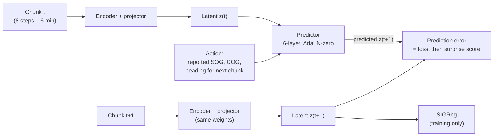

# Latent Wake

**JEPA surprise detection for maritime vessel tracks.**

Latent Wake trains a small Joint-Embedding Predictive Architecture (JEPA) world model on normal vessel motion from public AIS data. It then flags tracks where the model is *surprised*: the vessel ends up somewhere its own reported speed and course say it shouldn't be. That signature covers spoofed positions, teleports, AIS gaps, loitering, and ship-to-ship rendezvous.

The model follows the [LeWorldModel](https://arxiv.org/abs/2603.19312) recipe (a next-latent prediction loss plus the SIGReg Gaussian regularizer, with no EMA, stop-gradient, or pretrained encoder), ported from pixels to trajectories. It is sized to train on a single laptop GPU (RTX A4500, 16 GB).

> **Status:** Week 1 of a 12-week build. The full pipeline (download, preprocessing, anomaly injection, model, baselines, training, and evaluation) is written and tested end to end on synthetic traffic. The first run on real NOAA data is next. The full scope is in [`docs/SCOPE.md`](docs/SCOPE.md).

## Why

In the June 2026 [equation-grounded maritime anomaly benchmark](https://arxiv.org/abs/2606.29721), every tested detector scored near chance (AUROC about 54) on *unexpected AIS activity*: position jumps with no matching change in reported speed or course. That is the classic spoofing signature. A world model that has learned how position should follow from reported kinematics is a natural fit for catching it. As far as I can find, no one has tried a JEPA on it yet.

## How it works



- **Observation:** a 16-minute chunk of relative motion (east/north displacement, SOG, sin/cos COG, heading delta).
- **Action:** what the vessel's AIS *claims* it will do next (reported SOG, COG, heading).
- **Loss:** `MSE(predicted z(t+1), z(t+1)) + λ · SIGReg(Z)`, with one hyperparameter.
- **Surprise score:** the same prediction error at inference, robust-z-scored per vessel type.

## Data

| Dataset | Role |
| --- | --- |
| [NOAA MarineCadastre AIS](https://marinecadastre.gov/ais) | Pretraining on normal traffic in Chesapeake Bay and Hampton Roads (three months to start) |
| [OMTAD](https://ro.ecu.edu.au/ecuworkspost2013/11764) | Benchmark evaluation (Australian waters, CC BY-NC, not redistributed here) |
| [Equation-grounded anomaly benchmark](https://github.com/snudial/open-maritime-anomaly-detection) | Labeled test sets (A1 spoofing-like, A2 route deviation, A3 close approach) |

Synthetic anomalies (position spoof, teleport, route deviation, loitering, rendezvous, AIS gap) are injected into held-out tracks with seeded, deterministic generators and a severity knob for each type.

## Evaluation plan

- **Baselines:** Kalman-filter innovation residual, Isolation Forest, LSTM autoencoder, the same predictor on raw features (the key JEPA ablation), and a TrAISformer-style forecaster.
- **Metrics:** AUROC, AUPRC, and best F1 per anomaly type; detection rate versus severity; false alarms per 1,000 vessel-hours; time to detect.
- **Ablations:** SIGReg weight, SIGReg vs. VICReg vs. EMA/stop-gradient, action conditioning on/off, context length, latent size.
- **Rigor:** 3 seeds per configuration; test sets frozen before the first model run.

## Roadmap

| Phase | Weeks | Gate |
| --- | --- | --- |
| 1. Data pipeline and test sets | 1–3 | Test sets frozen before any model run |
| 2. JEPA and quick baselines | 4–6 | JEPA trains without collapse across 3 seeds |
| 3. Full evaluation and ablations | 7–9 | Results tables frozen |
| 4. Darkwater demo panel and write-up | 10–12 | Repo, write-up, and demo shipped |

## Repository layout

```
latent-wake/
  configs/        # Hydra configs: data, model, train, eval, ablations
  latentwake/
    data/         # download, clean, segment, resample, windows
    inject/       # seeded synthetic anomaly generators
    models/       # encoder, predictor, SIGReg, baselines
  notebooks/      # latent probes, failure analysis, figures
  tests/
  reports/        # results tables and write-up figures
  docs/SCOPE.md   # full project scope
```

## Stack

Python 3.11, PyTorch (CUDA), uv, Hydra, Polars + DuckDB, Weights & Biases or MLflow, pytest.

## Getting started

```bash
git clone https://github.com/PCSchmidt/latent-wake.git
cd latent-wake
uv venv --python 3.11
# Windows: .venv\Scripts\activate    macOS/Linux: source .venv/bin/activate
uv pip install -e ".[dev]"
pytest -q
```

### Step 1: download and crop AIS data

```bash
python -m latentwake.data.download --region chesapeake --start 2025-04-01 --end 2025-06-30
```

This streams each NOAA national daily file (`ais-YYYY-MM-DD.csv.zst`), crops it to the Chesapeake Bay and Hampton Roads box with DuckDB, writes `data/interim/chesapeake/ais-YYYY-MM-DD.parquet`, and deletes the national file. Re-running skips finished days. `data/interim/chesapeake/manifest.jsonl` records rows, vessels, and any failures for each day.

Useful flags: `--workers 2` (days in parallel), `--keep-raw` (keep national files, which are large), `--memory-limit 4GB` (DuckDB memory per worker). Try a single day first (`--start 2025-04-01 --end 2025-04-01`) and check the manifest's `missing_optional` field to confirm the schema matched.

The box in `latentwake/data/regions.py` is a loose first pass. Plot the first day's points and tighten it if needed. Only 2025-and-later daily files are supported so far.

### Step 2: clean, resample, and window

```bash
python -m latentwake.data.preprocess --interim data/interim/chesapeake --out data/processed/chesapeake
```

Keeps Class A transceivers only (contract v2; `--transceivers all` for the Class B secondary analysis, written to another `--out`), drops bad identities, NOAA "not available" sentinels, duplicates, and single-report position glitches; splits each vessel into tracks at silences over 30 minutes (logged to `gaps.parquet`); resamples to a shared 2-minute grid, marking any step that would need more than 3 missing steps of interpolation as invalid; computes per-step relative-motion features and a 0.05° location grid cell (used only by the position-context option); and cuts 64-step windows (about 2 hours) with stride 16 over fully valid stretches only.

Splits are by time *and* vessel: training uses 70% of vessels before the cutoff (two-thirds through the data by default); validation and test use the other 30% after it. No vessel or time period appears on both sides. Feature statistics come from the training split only. `stats.json` records row counts at every stage.

### Step 3: build and freeze a test set

```bash
python -m latentwake.inject.build --processed data/processed/chesapeake --split test \
    --out data/testsets/chesapeake-test-v2
```

Injects seeded anomalies into copies of held-out windows, one cell per kind and severity level, alongside untouched normal windows. The output carries a SHA-256 checksum: loading verifies it, and saving refuses to overwrite, so the test set is fixed before any model sees it.

| Kind | What changes | Severity knob |
| --- | --- | --- |
| `position_spoof` | Positions shift; reported speed and course do not | Offset, 0.1 to 5 nmi |
| `teleport` | One report jumps, then returns | Distance, 0.1 to 5 nmi |
| `ais_gap` | Vessel goes dark, reports go stale, reappears displaced | Gap length × jump distance |
| `route_deviation` | Vessel turns off its route, reports stay consistent | Turn, 5° to 90° |
| `loitering` | Transit replaced by slow circling, reports stay consistent | Duration, 16 to 64 min |

The first three are kinematically *inconsistent* (positions contradict reported motion). The last two are *consistent* (only the behavior is unusual), which tests whether a model learned normal behavior rather than just physics.

**Evaluation rule (contract v2):** `route_deviation` and `loitering` are injected only into moving cargo, tanker, and passenger windows, and scored only against normal windows from that same population (moving, `source_mean_sog >= 3`, transit class). Loitering is ordinary work for a tug or fishing boat, and anchored ships are trivially "normal," so any other comparison rewards telling vessel types or motion apart, not finding anomalies. On synthetic data, a plain physics-consistency check scores about 0.73 AUROC on them unmatched and 0.48 matched. The kinematic kinds go into every Class A vessel.

### Step 4: train

```bash
python -m latentwake.train --processed data/processed/chesapeake --out runs/jepa-s0 --seed 0
```

Defaults follow LeWorldModel: SIGReg weight 0.09 with 17 knots and 1,024 projections, AdamW, gradient clip 1.0, no EMA or stop-gradient. Learning rate 3e-4 with warmup and cosine decay, batch 256, 30 epochs, bf16 on CUDA. Anchored and moored windows are kept at 25% (`--stationary-keep`) so they don't dominate training.

Each epoch logs training and validation prediction loss, SIGReg, and `val_erank`, the effective rank of validation latents. A healthy run stays well above 1. A slide toward 1 means collapse, and the log flags it. Ablations are flags: `--target raw` (no encoder, no SIGReg), `--no-action`, `--sigreg-weight 0`. Architecture options, chosen on validation data only: `--pooling attention`, `--chunk-len 4`, `--use-position` (adds a location-cell embedding per chunk). `--size small` is a 0.8M-parameter version for CPU debugging; the full model is 10.1M.

### Step 5: evaluate

```bash
python -m latentwake.evaluate --testset data/testsets/chesapeake-test-v2 \
    --processed data/processed/chesapeake --out reports/eval-v2 \
    --model jepa=runs/jepa-s0/best.pt --model raw=runs/raw-s0/best.pt
```

Always includes two non-learned baselines: a physics residual (observed motion versus reported speed and course) and a constant-velocity Kalman filter that observes position and reported velocity and scores each step by normalized innovation squared. Every detector is calibrated per stratum, vessel class × under way (mean reported speed ≥ 1 kn), on the validation split (median and MAD), so a fishing boat's jitter isn't scored like a tanker's and an anchored tanker isn't scored like one in the channel. Writes AUROC and AUPRC per anomaly cell to `results.csv` and `summary.md`.

### Working offline with synthetic traffic

```bash
python -m latentwake.data.synthetic --days 9 --vessels 50 --out data/interim/synthetic
python -m latentwake.data.preprocess --interim data/interim/synthetic --out data/processed/synthetic
```

`latentwake.data.synthetic` writes days in exactly the download step's format: simple ship kinematics (transits, tugs, ferries, fishing boats, anchored ships) with realistic reporting flaws. It has no coastline and is not a model of the real bay. It exists for tests and for building the model before real data arrives.

## Governance: Meridian gates

This project runs under [Meridian](https://github.com/PCSchmidt/meridian) (`ml-research` recipe), adapted to the 12-week plan. Each phase ends at a gate that a script, not an agent's say-so, decides:

| Gate | Passes when | Check |
|---|---|---|
| `data_contract` (owner approves) | DATA_CONTRACT.md has no open `[DECIDE]` items and complete thresholds | `validate-data-contract.sh` |
| `pipeline_validated` | Real data cropped with no failed days, splits leak-free, test set frozen | `validate-schema/preprocessing/splits/testset.sh`, unit tests |
| `training_stable` | Three or more seeds per latent model, none collapsed | `validate-training.sh` |
| `model_eval` (owner approves) | Every model trained after the test set froze; every contract criterion met | `run-benchmark.sh`, `validate-metrics.sh` |
| `ablation_study` (owner approves) | ABLATION_RESULTS.md written | — |
| `demo_shipped` (owner approves) | Write-up, model card, changelog; full test suite green | `run-all-tests.sh` |

```bash
bash scripts/gate-engine.sh current                 # which gate is open
bash scripts/gate-engine.sh verify data_contract    # run its checks
bash scripts/gate-engine.sh mark-passed data_contract --approve "DATA CONTRACT APPROVED"   # owner only
```

Paths for every check live in `configs/eval.yaml`. The checks themselves are in `latentwake/checks.py`; each exits 2 to block. The success criteria are in [`DATA_CONTRACT.md`](DATA_CONTRACT.md), and the decision log is in [`DECISIONS.md`](DECISIONS.md). Meridian needs `jq` and [mikefarah's `yq`](https://github.com/mikefarah/yq).

## Related projects

- [Darkwater](https://github.com/PCSchmidt/darkwater): maritime shadow-fleet demo. Latent Wake scores will feed a ranked-vessel panel there.
- [chokepoint_app](https://github.com/PCSchmidt/chokepoint_app): maritime chokepoint intelligence.

## Acknowledgments

The training recipe builds on [LeWorldModel](https://github.com/lucas-maes/le-wm) by Maes, Le Lidec, Scieur, LeCun, and Balestriero. SIGReg and the AdaLN-zero transformer blocks in `latentwake/models/blocks.py` are adapted from that repository (MIT License, copyright 2026 Lucas Maes).

## License

MIT. Third-party datasets keep their own licenses and are not redistributed.
