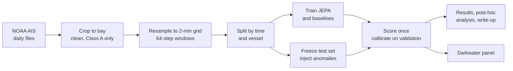
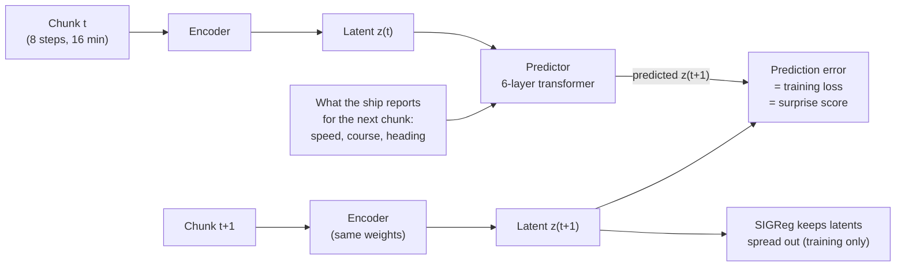
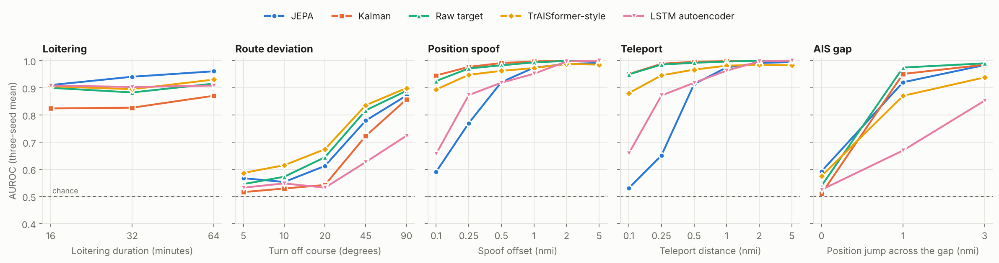
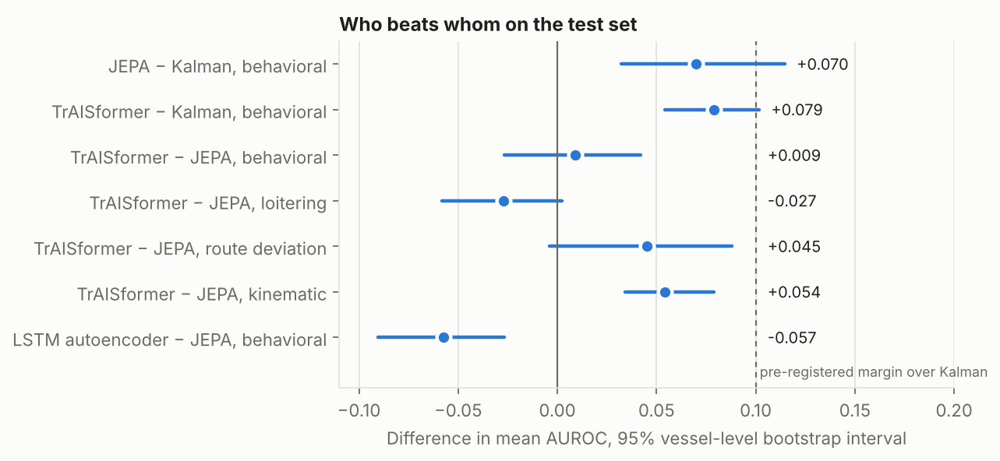
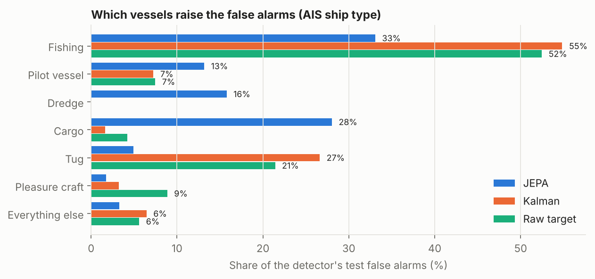

# Latent Wake

**Can a self-supervised world model spot unusual ship behavior better than a classical tracking filter?**

Latent Wake is a research project that trains a small *world model* on three months of real ship-tracking (AIS) data from Chesapeake Bay and Hampton Roads, then uses the model's **surprise** (how badly it predicts what a ship does next) to flag anomalies. It was benchmarked honestly against seven other detectors under success criteria written down before any real data was touched.

I built it to learn about **world models** by building one. Anomaly detection is the test bed: it gives a hard, checkable answer to whether the model actually learned how ships move. [Section 1](#1-why-world-models) explains why I chose it and what the project showed about world models.

**[Write-up](docs/WRITEUP.md)** · **[Live demo panel](https://pcschmidt.github.io/darkwater/latent-wake.html)** · **[Full results](EVAL_RESULTS.md)** · **[Model card](MODEL_CARD.md)** · **[Reproduce it](docs/REPRODUCE.md)**

> **Status: shipped (2026-11-11).** All six project gates passed. The frozen test set was scored once: **3 of 8 pre-registered success criteria met.** Scoped on November 5 as a 12-week plan, built and shipped in a week.

---

## At a glance

- **Why:** to learn how world models behave on real data. This one is action-conditioned, learns its own representation, and predicts in a latent space. The questions it answers are world-model questions: does the training recipe transfer to a new domain, does the model use its actions, and does predicting in latent space help? ([Section 1](#1-why-world-models))
- **What:** a JEPA (joint-embedding predictive architecture) world model, following [LeWorldModel](https://arxiv.org/abs/2603.19312), adapted from video frames to vessel tracks and trained on one laptop GPU.
- **Data:** 43.9 million real AIS reports (NOAA, April–June 2025), narrowed to 21.9 million from about 2,400 commercial (Class A) vessels.
- **Test:** 11,600 two-hour windows from 180 vessels the models never saw, with five kinds of anomaly injected at graded severities so the right answers are known.
- **Compared against:** a Kalman filter, a physics check, a raw-feature predictor, an LSTM autoencoder, an Isolation Forest, a TrAISformer-style forecaster, and a fused JEPA + Kalman detector.
- **Main finding:** models that predict a ship's next move beat the Kalman filter on *behavioral* anomalies (loitering, leaving a route) by about 0.07–0.08 AUROC. Whether that prediction happens in a learned latent space (the JEPA) or directly on the observations (the forecaster) made no measurable difference there. Neither cleared the pre-registered 0.10 margin.
- **Where the JEPA stands out:** best detector of loitering (0.94 AUROC). **Where it doesn't:** small position spoofs, where a Kalman filter that reads the ship's reported velocity is nearly perfect.
- **Engineering:** a gated, test-driven pipeline (92 tests) in which a script, not anyone's say-so, decides when a phase is done. The test set was checksummed, frozen before training, and could only be scored once.

---

## Contents

1. [Why world models](#1-why-world-models)
2. [The problem](#2-the-problem)
3. [Objectives and scope](#3-objectives-and-scope)
4. [How it works](#4-how-it-works)
5. [Data and pipeline](#5-data-and-pipeline)
6. [How it was tested](#6-how-it-was-tested)
7. [Results](#7-results)
8. [What I learned](#8-what-i-learned)
9. [Limitations and responsible use](#9-limitations-and-responsible-use)
10. [What's next](#10-whats-next)
11. [How the project was run](#11-how-the-project-was-run)
12. [Repository guide](#12-repository-guide)
13. [References and acknowledgments](#13-references-and-acknowledgments)

---

## 1. Why world models

A **world model** learns how an environment changes in response to actions, so it can predict, or imagine, what happens next. That idea sits behind much of the recent progress in robotics and video understanding. The **JEPA** family, which predicts in a learned representation rather than in pixels, is one of its most active branches. I wanted to understand world models by building one end to end on real, messy data, not only by reading about them.

**The evidence that this was the aim from the start:**

- The project decision in [`DECISIONS.md`](DECISIONS.md) (November 5) chose between three world-model projects: a straight reproduction of LeWorldModel, frozen V-JEPA 2.1 features on overhead video, and this one. Latent Wake won because it is original, laptop-sized, and builds on my earlier maritime projects ([Darkwater](https://github.com/PCSchmidt/darkwater), chokepoint_app).
- The model is a faithful adaptation of [LeWorldModel](https://arxiv.org/abs/2603.19312) (LeWM), carried from video frames to vessel tracks:
  - its SIGReg regularizer with the published defaults
  - its action-conditioned AdaLN-zero predictor
  - no EMA target network and no stop-gradient
  - a latent-rank monitor to catch collapse
- The test is the one LeWM uses to show a world model has learned physics: **violation of expectation**. LeWM's surprise spikes when an object in a scene teleports. A ship whose position jumps, or whose behavior stops matching its reports, is the maritime version. Injecting those events with known ground truth turns "did the model learn how ships move?" into a measurable question.
- Most of the work went into world-model questions rather than detector tuning. Nine ablations isolate the regularizer, the actions, the latent space, the latent size, and the context length ([`ABLATION_RESULTS.md`](ABLATION_RESULTS.md)).

**What the project showed about world models** (validation ablations unless noted):

| Question | Evidence | Answer |
|---|---|---|
| Does the LeWM recipe transfer from pixels to tracks? | Three seeds trained stably with LeWM's defaults and none of the usual anti-collapse tricks; latent rank 125 of 192 | Yes, unchanged |
| Is SIGReg doing the work, and is it fragile? | Weight 0: collapse to rank 2.6 of 192, worse than Kalman. Weights 0.02 to 0.3 (a 15× range): behavioral AUROC moves at most 0.012 | Necessary, and insensitive to its one setting, as LeWM claims |
| Does the model use its actions? | Without the ship's reported speed and course, prediction error is about 30× higher (0.064 vs 0.0021) and AUROC drops by 0.04 to 0.05 | Yes. Action conditioning carries most of the prediction. On the smallest spoofs it also lets the model explain the offset away |
| Does predicting in a latent space help? | Same predictor on raw targets: loitering 0.727 vs 0.800, but kinematic anomalies +0.101. On test, an observation-space forecaster ties the JEPA on behavior (+0.009, interval −0.027 to +0.042) | It trades fine detail for behavior. For detecting anomalies here, not a measurable edge overall |
| How big a latent does it need? | A 64-dim latent matches 192 on behavior, is better on kinematics (+0.029) and uses 61 of its 64 dimensions | Small. The extra capacity was mostly unused |
| Is surprise the same as anomaly? | On test, four benign vessels (pilot boat, dredge, fishing boat, moored cargo ship) raise 85% of the JEPA's false alarms | No. Surprise measures novelty to the model, not intent |

**What it did not test.** Latent Wake used its world model for one thing only, one-step surprise. The capabilities that make world models matter remain open:

- imagining several steps ahead
- answering what-if questions about actions a ship never took
- planning

Those are the next questions ([section 10](#10-whats-next)).

## 2. The problem

Most large ships broadcast an **Automatic Identification System (AIS)** message every few seconds: who they are, where they are, and their speed, course, and heading. Coast guards, ports, insurers, and sanctions analysts rely on it. It is also easy to abuse. A transponder can be switched off ("going dark"), fed a false position ("spoofing"), or used honestly by a ship doing something unusual: loitering where it has no business, or leaving its route to meet another vessel.

Finding these by hand does not scale, and machine learning has a labeling problem: there are very few confirmed incidents to learn from. A recent benchmark ([*Redefining Maritime Anomaly Detection via Equation-Grounded Synthetic Anomalies*](https://arxiv.org/abs/2606.29721), June 2026) found detectors near chance on position jumps that contradict a ship's reported motion, the classic spoofing signature.

A **world model** offers another route. Train it only on normal traffic to predict what a ship does next, given what the ship says it is doing. When the prediction goes badly wrong, something unusual happened. No labels are needed.

## 3. Objectives and scope

**Original objective** (from the [scope document](docs/SCOPE.md), November 5): test whether a JEPA world model, the approach behind recent self-supervised video and robotics models, can detect AIS anomalies better than classical methods, on a laptop, in 12 weeks, with results honest enough to stand up to scrutiny.

**Pre-registered claims** (fixed in [`DATA_CONTRACT.md`](DATA_CONTRACT.md) before any real data was used):

1. The JEPA beats a Kalman filter on behavioral anomalies by at least **0.10 AUROC** and **0.05 AUPRC**.
2. A fused JEPA + Kalman detector beats either one alone.
3. The fused detector holds a **1% false-alarm budget** set on validation data.

The headline was set on behavioral anomalies rather than spoofing because an early synthetic test showed a Kalman filter that reads reported velocity is very hard to beat on spoofing. That turned out to be right.

**Delivered against scope:**

| Scoped | Delivered |
|---|---|
| Data pipeline for three months of NOAA AIS | Done: 43.9M reports, cleaned, resampled, windowed, split by time and vessel |
| Frozen, checksummed anomaly test sets | Done: five anomaly kinds, graded severities, write-once with SHA-256 |
| JEPA trained without collapse, three seeds | Done: 10.1M parameters, about 40 minutes per seed |
| Baselines | Done: physics, Kalman, raw-target, Isolation Forest, LSTM autoencoder, TrAISformer-style, fused |
| Ablations | Done: nine, on validation, three seeds where results were close |
| Demo panel in [Darkwater](https://github.com/PCSchmidt/darkwater) | Done: [live](https://pcschmidt.github.io/darkwater/latent-wake.html) |
| Write-up | Done: [`docs/WRITEUP.md`](docs/WRITEUP.md) |
| OMTAD / equation-grounded benchmark | Not done |
| VICReg and EMA ablations | Deferred |
| Ship-to-ship rendezvous detection | Out of scope (needs pairs of vessels) |

## 4. How it works

### The idea in plain language

Imagine watching a ship for 16 minutes, then being told what its captain *says* it will do next ("12 knots, heading 040°"). An experienced pilot could picture where the ship will be. If it ends up somewhere else, or behaves in a way ships in that bay never do, that is worth a look. Latent Wake trains a neural network to be that pilot.

A **JEPA** does the predicting in a compressed internal representation (a *latent space*) rather than in raw coordinates. The bet is that a learned summary of motion captures *behavior* (transiting, maneuvering, circling) better than raw positions do. The risk is that the network learns a useless summary, for instance mapping every track to the same point (*collapse*). LeWorldModel's answer, used here, is **SIGReg**: a regularizer that keeps the latent codes spread out like a Gaussian cloud, with no other tricks needed.

### End to end



### The model



- **Input:** each two-hour window is cut into eight 16-minute chunks. Each step carries relative motion only (east and north displacement, reported speed, course, heading change), so the model learns motion, not the map.
- **The deliberate gap:** the predictor is told the ship's *reported* speed and course, never where it actually moved. If the positions disagree with the reports, the prediction fails.
- **Training:** prediction error plus 0.09 × SIGReg. No EMA target network, no stop-gradient, no pretrained encoder.
- **Scoring:** at test time, the same prediction error is converted to "how rare is this, among validation windows of the same vessel type and motion state", reported as a tail probability. An alert fires above a threshold that gives 1% false alarms on validation.

## 5. Data and pipeline

| Stage | What happens | Size |
|---|---|---|
| Download | NOAA MarineCadastre daily national files, April–June 2025, cropped to Chesapeake Bay and Hampton Roads with DuckDB | 43.9M reports |
| Population | Class A transceivers only (commercial vessels; Class B is mostly pleasure craft) | 21.9M reports, about 2,400 vessels |
| Clean | Drop bad identities, NOAA "not available" values, duplicates, single-report glitches | |
| Tracks | Split each vessel at silences over 30 minutes; resample to a 2-minute grid | 15,117 tracks |
| Windows | 64 steps (about 2 hours), stride 16, fully valid stretches only | 447K train · 60K validation · 56K test |
| Split | Training: April–May, 70% of vessels. Validation and test: June, two disjoint vessel sets | no vessel or period on both sides |

**Anomalies** are injected into copies of real held-out windows by seeded generators, so ground truth is exact:

| Kind | What changes | Severity |
|---|---|---|
| Position spoof | Positions shift; reported speed and course do not | 0.1 to 5 nautical miles |
| Teleport | One report jumps, then returns | 0.1 to 5 nmi |
| AIS gap | The ship goes quiet, then reappears displaced | 10–40 min × 0–3 nmi jump |
| Route deviation | The ship turns off its route; reports stay consistent | 5° to 90° |
| Loitering | Transit replaced by slow circling | 16 to 64 minutes |

The first three are **kinematic** (positions contradict what the ship reports). The last two are **behavioral** (the reports are consistent, only the behavior is odd). Behavioral anomalies go only into moving cargo, tanker, and passenger ships. A tug or fishing boat circling is normal work.

## 6. How it was tested

The project was designed so the results could not be quietly tuned to look good:

- **Pre-registration.** Success criteria and their numeric margins were written in [`DATA_CONTRACT.md`](DATA_CONTRACT.md) and approved before any model trained on real data.
- **Frozen test set.** It was built and checksummed before training, held out by time *and* vessel, and the benchmark code refuses to score it a second time with different inputs.
- **Validation only for choices.** Every architecture option, ablation, and baseline setting was chosen on a separate validation anomaly set.
- **Fair calibration.** Every detector, baselines included, is calibrated the same way, per vessel type and motion state.
- **Honest uncertainty.** Windows from one ship are correlated, so confidence intervals come from a bootstrap that resamples *vessels* (172 of them), not windows.
- **Changes on the record.** The contract was amended twice, both before the test set was scored, with the reason logged each time. Version 2 restricted the study to commercial vessels and fixed how behavioral anomalies were matched. Version 2.1 fixed a calibration flaw that sent 99% of the fused detector's alerts to stopped ships. The second amendment made the JEPA look *worse* (the Kalman baseline gained more from fair calibration) and was adopted anyway, with the margins unchanged. Every decision and its reason is in [`DECISIONS.md`](DECISIONS.md).

## 7. Results

Three-seed mean AUROC on the frozen test set (1.0 is perfect, 0.5 is chance). The last row is the false-alarm rate on normal test windows at the 1% budget set on validation.

| AUROC | JEPA | Kalman | Raw-target predictor | Fused JEPA + Kalman | TrAISformer-style | LSTM autoencoder | Isolation Forest |
|---|--:|--:|--:|--:|--:|--:|--:|
| Loitering | **0.938** | 0.841 | 0.900 | 0.904 | 0.910 | 0.907 | 0.448 |
| Route deviation | 0.677 | 0.634 | 0.694 | 0.664 | **0.722** | 0.592 | 0.502 |
| Position spoof | 0.872 | **0.985** | 0.979 | 0.976 | 0.958 | 0.900 | 0.905 |
| Teleport | 0.843 | **0.989** | 0.987 | 0.981 | 0.957 | 0.901 | 0.928 |
| AIS gap | 0.832 | 0.815 | **0.835** | **0.835** | 0.794 | 0.682 | 0.675 |
| False alarms on test normals | 5.0% | 2.1% | 2.5% | 4.1% | **1.6%** | 1.8% | 3.3% |

The last three columns were added after the main scoring, with settings chosen on validation and one separately recorded test scoring.



**Pre-registered verdict: 3 of 8 criteria met.**

| Criterion | Result | Required | Met |
|---|---|---|---|
| JEPA over Kalman, behavioral AUROC | +0.070 | +0.10 | no |
| JEPA over Kalman, behavioral AUPRC | +0.039 | +0.05 | no |
| Fused over Kalman, AUROC | +0.019 | +0.03 | no |
| Fused over Kalman, AUPRC | −0.061 | ≥ 0 | no |
| Fused over JEPA, AUROC | +0.040 | +0.03 | yes |
| Fused over JEPA, AUPRC | +0.117 | +0.03 | yes |
| Fused false alarms at the 1% budget | 4.1% | ≤ 2% | no |
| Fused detection at budget vs Kalman | 0.501 vs 0.483 | ≥ Kalman | yes |



## 8. What I learned

1. **Learned next-step predictors beat the Kalman filter on behavior, by a real but modest margin.** JEPA +0.070 AUROC (95% interval +0.032 to +0.115); TrAISformer-style forecaster +0.079 (+0.054 to +0.102). Both clearly above zero, neither confidently above the 0.10 I committed to.
2. **The latent space was not the secret ingredient.** On behavioral anomalies the JEPA and a simpler forecaster that predicts binned observations are statistically tied (+0.009, interval −0.027 to +0.042). The JEPA ranks loitering best. The forecaster is better on spoofs, teleports, and route deviation, and holds the false-alarm budget best.
3. **Physics wins on physics.** A Kalman filter that reads the ship's reported velocity is nearly perfect on spoofs and teleports. The JEPA, which pools 16 minutes into one latent, is near chance on the smallest ones.
4. **Thresholds did not travel between fleets.** A 1% budget on validation vessels became 2–5% on new vessels. The misses are concentrated: four vessels raise 85% of the JEPA's false alarms. One is a cargo ship moored at a Norfolk terminal, one a fishing boat working the mid-bay, one a Baltimore Harbor pilot boat, and one a Hampton Roads dredge. Pilot launches and dredges move like nothing in training, and the JEPA has no notion of where the channels are.

   

5. **The ablations explain the model.** Removing SIGReg collapses it (latent rank 2.6 of 192) and makes it worse than Kalman. Removing the reported-motion input raises prediction error about 30×. Predicting in latent space trades kinematic sensitivity for loitering. A smaller, 64-dimensional latent did as well on behavior and better on everything else. That was found after the test scoring, so it is the starting point for a next version rather than a swapped-in result. Details: [`ABLATION_RESULTS.md`](ABLATION_RESULTS.md).
6. **Process mattered as much as the model.** A diagnostic I added before scoring caught a calibration flaw that made the fused detector look fine on AUROC while it never alerted on a moving ship. The pre-registered criteria did not catch it. Fixing it fairly cost the JEPA two validation passes, and that cost is recorded rather than hidden.

## 9. Limitations and responsible use

- **Synthetic anomalies.** Real spoofing, loitering, and dark activity may not look like the injectors. The results measure detection of the injected patterns.
- **One region, one season, commercial vessels only.** Chesapeake Bay and Hampton Roads, April–June 2025, Class A transceivers.
- **Thresholds need local calibration.** On new vessels, the false-alarm rate was two to five times the budget.
- **Not for enforcement.** A flag means a track was unusual to a model, not that anyone did anything wrong. Vessels are anonymized in every published report and in the demo panel. The tracks themselves are public AIS.

## 10. What's next

**World-model questions** (these come first; they are why the project exists):

- **Imagined rollouts.** Feed the model's predictions back in for 4, 16 and 64 steps, and measure how fast the error grows. Compare it with the observation-space forecaster it tied on one-step surprise. Multi-step prediction is where a latent model is supposed to earn its keep, and Latent Wake only tested one step.
- **Counterfactual actions.** Give the predictor a course or speed change the ship never made, and check that the imagined track turns or slows by the right amount. This separates learned dynamics from memorized habits.
- **Probing the latent.** Find out which quantities the latent encodes (speed, heading, vessel type, distance to the channel) and which it discards.
- **Planning.** Use a world model the way LeWorldModel does: search over action sequences in latent space toward a goal, starting from a reproduction on one of LeWM's own control tasks.
- **Other world-model families.** Compare a JEPA, a Dreamer-style model that also reconstructs its observations, and a token-by-token forecaster on the same data and the same tests.

Any of these would run under a new pre-registered contract, on validation data or a new month of tracks. Test set v2 is never scored again.

**Detector improvements** (if the goal were a better AIS detector):

- Carry forward the **64-dimensional latent**, equal on behavior and better elsewhere on validation.
- Add a **fixed shipping-lane prior** (traffic density or charted channels) for route deviation. A learned per-cell location embedding helped there but overfit.
- **Fuse by anomaly kind** (Kalman for kinematic, a forecaster for behavioral) under a new pre-registration, instead of taking the maximum of two scores.
- **Per-vessel or per-fleet calibration**, so thresholds transfer, and context masks for pilot stations, anchorages, and dredging areas.
- Evaluate on the **equation-grounded benchmark** and run the deferred **VICReg / EMA** ablations.

## 11. How the project was run

The project ran under [**Meridian**](https://github.com/PCSchmidt/meridian), my own harness for governing AI-assisted engineering. Work moves through gates. Each gate passes only when scripted checks pass, and the four that carry judgment need my explicit approval in my own terminal:

| Gate | Passes when |
|---|---|
| `data_contract` (owner) | Success criteria and margins complete, no open decisions |
| `pipeline_validated` | Real data processed with no failed days, splits leak-free, test set frozen |
| `training_stable` | Three seeds per latent model, none collapsed |
| `model_eval` (owner) | Test set scored exactly once by the pre-registered rules, verdict recorded pass or fail |
| `ablation_study` (owner) | Ablations written up |
| `demo_shipped` (owner) | Write-up, model card, changelog; all tests green |

The code was written by an AI coding agent (Claude, through Claude Code). I acted as owner: scoping the project, choosing the region and claims, approving every gate and contract amendment, running all training on my laptop, and reviewing results. Meridian's job is to make that division of labor trustworthy. The agent cannot pass an owner gate, and the checks, not anyone's report of them, decide when work is done.

## 12. Repository guide

**Suggested reading order:** this README → [`docs/WRITEUP.md`](docs/WRITEUP.md) → [`EVAL_RESULTS.md`](EVAL_RESULTS.md) → [`DECISIONS.md`](DECISIONS.md).

| Document | What it is |
|---|---|
| [`docs/WRITEUP.md`](docs/WRITEUP.md) | The project write-up, with figures and references |
| [`EVAL_RESULTS.md`](EVAL_RESULTS.md) | Test results: generated tables, verdict, interpretation, baselines, intervals |
| [`ABLATION_RESULTS.md`](ABLATION_RESULTS.md) | What each model component contributes (validation) |
| [`MODEL_CARD.md`](MODEL_CARD.md) | Model details, data, intended use, limitations |
| [`DATA_CONTRACT.md`](DATA_CONTRACT.md) | The pre-registered success criteria and amendment log (unchanged since scoring) |
| [`DECISIONS.md`](DECISIONS.md) | Every decision, why, alternatives, and who made it |
| [`CHANGELOG.md`](CHANGELOG.md) | What changed in what is measured, by date |
| [`docs/SCOPE.md`](docs/SCOPE.md) | The original 12-week scope, kept as written |
| [`docs/REPRODUCE.md`](docs/REPRODUCE.md) | Every command, from download to demo panel |
| [`SPEC.md`](SPEC.md), [`CONTRACT.md`](CONTRACT.md), [`MERIDIAN.md`](MERIDIAN.md) | Meridian's feature spec, project contract, and generated rules |
| [`reports/`](reports/) | Validation reports, test-set manifests, raw results, post-hoc analysis |

| Code | What it does |
|---|---|
| `latentwake/data/` | Download, crop, clean, resample, window, split; synthetic traffic for tests |
| `latentwake/inject/` | Seeded anomaly injectors; write-once, checksummed test sets |
| `latentwake/models/` | The JEPA (encoder, predictor, SIGReg), Kalman and physics baselines, learned baselines |
| `latentwake/train.py`, `train_baseline.py`, `select_baselines.py` | Training and validation-only model selection |
| `latentwake/score.py`, `evaluate.py` | Calibration and evaluation |
| `latentwake/checks.py` | The gate checks; the benchmark that scores the test set once |
| `latentwake/posthoc.py`, `export_panel.py` | Bootstrap intervals, false-alarm forensics, demo export |
| `scripts/` | Meridian gate scripts and figure generation |
| `tests/` | 92 tests, run as part of the final gate |

**Stack:** Python 3.11, PyTorch, DuckDB, pandas, NumPy, scikit-learn, pytest; Meridian for gates; the demo is SQLite in the browser (sql.js) on GitHub Pages. **Hardware:** one laptop, RTX A4500 (16 GB).

**Run it:** see [`docs/REPRODUCE.md`](docs/REPRODUCE.md). In short:

```bash
git clone https://github.com/PCSchmidt/latent-wake.git && cd latent-wake
uv venv --python 3.11 && source .venv/bin/activate   # Windows: .venv\Scripts\activate
uv pip install -e ".[dev]" && pytest -q
```

## 13. References and acknowledgments

- Maes, Le Lidec, Scieur, LeCun, and Balestriero. *LeWorldModel: Stable End-to-End Joint-Embedding Predictive Architecture from Pixels.* [arXiv:2603.19312](https://arxiv.org/abs/2603.19312), 2026 ([project page](https://le-wm.github.io/), [code](https://github.com/lucas-maes/le-wm)). SIGReg and the AdaLN-zero transformer blocks in `latentwake/models/blocks.py` are adapted from that repository (MIT License, copyright 2026 Lucas Maes).
- Balestriero and LeCun. *LeJEPA: Provable and Scalable Self-Supervised Learning Without the Heuristics.* [arXiv:2511.08544](https://arxiv.org/abs/2511.08544), 2025. The origin of SIGReg.
- Nguyen and Fablet. *TrAISformer: A Transformer Network with Sparse Augmented Data Representation and Cross Entropy Loss for AIS-based Vessel Trajectory Prediction.* [arXiv:2109.03958](https://arxiv.org/abs/2109.03958). The forecaster baseline follows it.
- *Redefining Maritime Anomaly Detection via Equation-Grounded Synthetic Anomalies.* [arXiv:2606.29721](https://arxiv.org/abs/2606.29721), 2026. The motivation for the kinematic anomaly kinds.
- AIS data: [NOAA / BOEM MarineCadastre](https://marinecadastre.gov/ais), public domain.

**Related projects:** [Darkwater](https://github.com/PCSchmidt/darkwater) (shadow-fleet surveillance demo where SQLite is the whole application; hosts the Latent Wake panel) · [Meridian](https://github.com/PCSchmidt/meridian) (the harness that governed this build) · [chokepoint_app](https://github.com/PCSchmidt/chokepoint_app) (maritime chokepoint intelligence).

## License

MIT. Third-party datasets keep their own licenses and are not redistributed.
