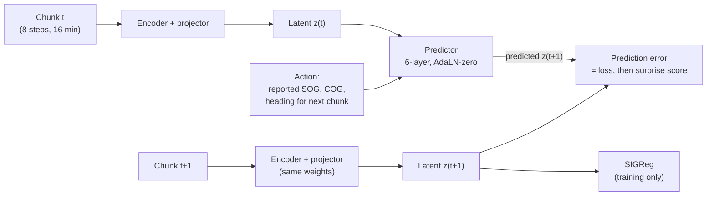

# Latent Wake

**JEPA surprise detection for maritime vessel tracks.**

Latent Wake trains a small Joint-Embedding Predictive Architecture (JEPA) world model on normal vessel motion from public AIS data. It then flags tracks where the model is *surprised*: the vessel ends up somewhere its own reported speed and course say it shouldn't be. That signature covers spoofed positions, teleports, AIS gaps, loitering, and ship-to-ship rendezvous.

The model follows the [LeWorldModel](https://arxiv.org/abs/2603.19312) recipe (a next-latent prediction loss plus the SIGReg Gaussian regularizer, with no EMA, stop-gradient, or pretrained encoder), ported from pixels to trajectories. It is sized to train on a single laptop GPU (RTX A4500, 16 GB).

> **Status:** Planning. Week 0 of a 12-week build. The full scope is in [`docs/SCOPE.md`](docs/SCOPE.md).

## Why

In the June 2026 [equation-grounded maritime anomaly benchmark](https://arxiv.org/abs/2606.29721), every tested detector scored near chance (AUROC about 54) on *unexpected AIS activity*: position jumps with no matching change in reported speed or course. That is the classic spoofing signature. A world model that has learned how position should follow from reported kinematics is a natural fit for catching it. As far as I can find, no one has tried a JEPA on it yet.

## How it works



- **Observation:** a 16-minute chunk of relative motion (east/north displacement, SOG, sin/cos COG, heading delta).
- **Action:** what the vessel's AIS *claims* it will do next (reported SOG, COG, heading).
- **Loss:** `MSE(predicted z(t+1), z(t+1)) + λ · SIGReg(Z)`, with one hyperparameter.
- **Surprise score:** the same prediction error at inference, robust-z-scored per vessel type.

## Data

| Dataset | Role |
| --- | --- |
| [NOAA MarineCadastre AIS](https://marinecadastre.gov/ais) | Pretraining on normal traffic in Chesapeake Bay and Hampton Roads (three months to start) |
| [OMTAD](https://ro.ecu.edu.au/ecuworkspost2013/11764) | Benchmark evaluation (Australian waters, CC BY-NC, not redistributed here) |
| [Equation-grounded anomaly benchmark](https://github.com/snudial/open-maritime-anomaly-detection) | Labeled test sets (A1 spoofing-like, A2 route deviation, A3 close approach) |

Synthetic anomalies (position spoof, teleport, route deviation, loitering, rendezvous, AIS gap) are injected into held-out tracks with seeded, deterministic generators and a severity knob for each type.

## Evaluation plan

- **Baselines:** Kalman-filter innovation residual, Isolation Forest, LSTM autoencoder, the same predictor on raw features (the key JEPA ablation), and a TrAISformer-style forecaster.
- **Metrics:** AUROC, AUPRC, and best F1 per anomaly type; detection rate versus severity; false alarms per 1,000 vessel-hours; time to detect.
- **Ablations:** SIGReg weight, SIGReg vs. VICReg vs. EMA/stop-gradient, action conditioning on/off, context length, latent size.
- **Rigor:** 3 seeds per configuration; test sets frozen before the first model run.

## Roadmap

| Phase | Weeks | Gate |
| --- | --- | --- |
| 1. Data pipeline and test sets | 1–3 | Test sets frozen before any model run |
| 2. JEPA and quick baselines | 4–6 | JEPA trains without collapse across 3 seeds |
| 3. Full evaluation and ablations | 7–9 | Results tables frozen |
| 4. Darkwater demo panel and write-up | 10–12 | Repo, write-up, and demo shipped |

## Repository layout

```
latent-wake/
  configs/        # Hydra configs: data, model, train, eval, ablations
  latentwake/
    data/         # download, clean, segment, resample, windows
    inject/       # seeded synthetic anomaly generators
    models/       # encoder, predictor, SIGReg, baselines
  notebooks/      # latent probes, failure analysis, figures
  tests/
  reports/        # results tables and write-up figures
  docs/SCOPE.md   # full project scope
```

## Stack

Python 3.11, PyTorch (CUDA), uv, Hydra, Polars + DuckDB, Weights & Biases or MLflow, pytest.

## Related projects

- [Darkwater](https://github.com/PCSchmidt/darkwater): maritime shadow-fleet demo. Latent Wake scores will feed a ranked-vessel panel there.
- [chokepoint_app](https://github.com/PCSchmidt/chokepoint_app): maritime chokepoint intelligence.

## Acknowledgments

The training recipe builds on [LeWorldModel](https://github.com/lucas-maes/le-wm) by Maes, Le Lidec, Scieur, LeCun, and Balestriero. SIGReg code will be adapted from that repository with attribution.

## License

MIT. Third-party datasets keep their own licenses and are not redistributed.
