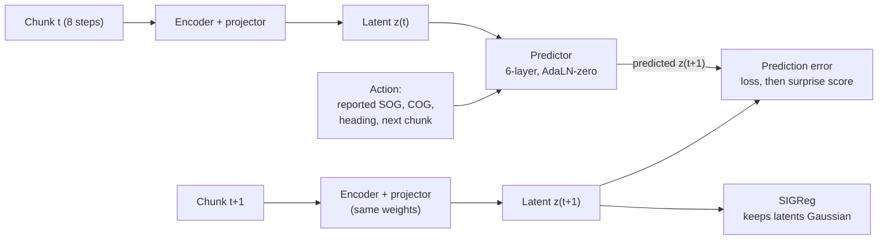

# Latent Wake: JEPA Surprise Detection for Maritime Tracks

*Project scope, November 5, 2026. Chris Schmidt.*

## Summary

Latent Wake trains a small JEPA world model on normal vessel motion from public AIS data, then flags tracks where the model is surprised. It runs entirely on a Dell Precision 7770 (RTX A4500, 16 GB VRAM), in about 12 weeks of part-time work.

**Hypothesis.** A JEPA trained with only a prediction loss plus SIGReg (the LeWorldModel recipe) learns a latent space where latent prediction error separates anomalous tracks from normal ones better than a pixel-free generative baseline. Anomalies here are spoofed jumps, identity swaps, AIS gaps, loitering, and ship-to-ship rendezvous.

**Success looks like:**

- Higher AUROC and AUPRC than an LSTM autoencoder and a Kalman-filter residual detector on a held-out test set with injected anomalies.
- Competitive results on at least one public labeled anomaly benchmark.
- An honest ablation table showing what SIGReg, the predictor, and the context length each contribute.
- A live demo panel in Darkwater that ranks vessels by surprise score.
- A write-up on the portfolio site with code, configs, and model weights.

## Why this project

The project targets a gap that the newest maritime benchmark leaves open. In the June 2026 equation-grounded benchmark, every tested model scored near chance (AUROC about 54) on unexpected AIS activity: position jumps with no matching change in speed or course. That signature is classic spoofing. A world model that has learned how position should follow from speed and course is a natural candidate for catching it, and nobody has tried a JEPA on it yet ([benchmark paper](https://www.emergentmind.com/papers/2606.29721)).

- **Portfolio fit.** It is a Tier 1 project: an original model, a benchmark with baselines, and ablations. It also shows hands-on fluency with the newest self-supervised method, not just API use.
- **Defense relevance.** Dark-vessel and spoofing detection is a live maritime domain awareness problem.
- **Reuse.** Darkwater and chokepoint_app already handle maritime data and display. Latent Wake adds a learned detection layer underneath them instead of starting a new app.
- **Laptop-sized.** LeWorldModel is about 15M parameters and trains in hours on one GPU. A trajectory version with no pixel encoder is smaller still.

## Data

Train on unlabeled NOAA AIS for US waters, and evaluate on synthetic anomalies plus the public OMTAD benchmark. Both datasets are free and need no account.

| Dataset | Role | Coverage | Format | Notes |
| --- | --- | --- | --- | --- |
| [NOAA MarineCadastre AIS](https://www.fisheries.noaa.gov/inport/item/77594) | Pretraining (normal behavior) | US coastal waters, daily files from 2015 | CSV, Zstandard-compressed daily files from 2025 | Fields: MMSI, time, lat, lon, SOG, COG, heading, vessel type, size, draft |
| [OMTAD](https://ro.ecu.edu.au/ecuworkspost2013/11764) | Benchmark evaluation | Australian SAR region, 2018 to 2020 | Cleaned tracks by month | Cargo, tanker, fishing, passenger; journeys of 10+ hours, no gaps; CC BY-NC license |
| [Equation-grounded anomaly benchmark](https://github.com/snudial/open-maritime-anomaly-detection) | Labeled test sets | Built on OMTAD | Timestamp-level labels | Anomaly types A1 (spoofing-like jumps), A2 (route deviation), A3 (close approach) |

NOAA files are large, so start with one region (Chesapeake Bay and Hampton Roads) and three months. That area mixes deep-draft traffic into Baltimore and Norfolk with tugs, ferries, and Navy vessels, so it is a harder and more defense-relevant baseline than a pure container port. Scale up only after the pipeline works end to end. OMTAD covers Australian waters, which also lines up with Oceania-region work.

**Preprocessing pipeline**

1. Download daily files for the chosen region and months; decompress and load into Parquet partitioned by day.
2. Clean: drop invalid MMSIs, out-of-range SOG (over 50 knots), points on land, and duplicate timestamps.
3. Segment each vessel into tracks, splitting at gaps over 30 minutes. Keep the gap events in a side table; they become labeled AIS-gap examples later.
4. Resample each track to a fixed 2-minute step with linear interpolation, capped at 3 missing steps.
5. Build per-step features: displacement in local east and north meters, SOG, sin and cos of COG, heading delta, time delta, and a vessel-type ID. Use relative motion, not absolute lat and lon, so the model learns physics instead of memorizing lanes.
6. Normalize with statistics from the training split only.
7. Cut sliding windows of 64 steps (about 2 hours) with stride 16.

**Splits.** Split by time and by MMSI together: train on months 1 and 2, validate and test on month 3, with test vessels unseen in training. This prevents a vessel's own track from leaking into evaluation.

**Tooling.** Polars or DuckDB for the pipeline, Parquet on disk, and a small PyTorch Dataset that reads windows into memory.

## Model design

Port the LeWorldModel recipe from pixels to trajectories: an encoder, an action-conditioned predictor, and a two-term loss with no EMA, stop-gradient, or pretrained encoder ([LeWM paper](https://arxiv.org/html/2603.19312), [official code](https://github.com/lucas-maes/le-wm)).

**Observations and actions.** Each 64-step window is cut into 8 chunks of 8 steps (16 minutes each). A chunk's observed motion (displacements, SOG, COG) is the observation. The reported SOG, COG, and heading for the next chunk act as the action. This framing is the core idea: the model learns where a ship should end up given what its AIS claims about speed and course. A spoofed position that disagrees with the reported kinematics should produce a large prediction error.



The same prediction error is the training loss and, at inference, the surprise score; SIGReg only runs during training.

**Components**

| Part | Design | Approx. params |
| --- | --- | --- |
| Chunk encoder | Linear embed per step, 4-layer transformer, width 192, mean-pool to a 192-dim latent | ~1.8M |
| Projector | Linear plus BatchNorm1d (LeWM uses BatchNorm, not LayerNorm, so SIGReg gradients flow) | <0.1M |
| Action encoder | MLP from next-chunk SOG, COG, heading to a conditioning vector | <0.1M |
| Predictor | 6-layer causal transformer, width 256, AdaLN-zero action conditioning, predicts the next latent | ~4.7M |
| Total | | ~7M |

Parameter counts are estimates from the layer sizes; confirm them in the first training run.

**Loss.** Next-latent prediction plus the Sketched Isotropic Gaussian Regularizer. SIGReg projects the batch of latents onto random unit directions and penalizes the Epps-Pulley distance from a standard normal along each one. That keeps latents spread out and blocks collapse.

```math
\mathcal{L} = \frac{1}{T}\sum_{t} \lVert \hat{z}_{t+1} - z_{t+1} \rVert_2^2 \;+\; \lambda \, \mathrm{SIGReg}(Z)
```

The only loss hyperparameter is the SIGReg weight. Tune it by bisection on validation prediction loss, checking that latent effective rank stays high.

**Fit on the laptop.** About 7M parameters, a batch of 512 windows, and mixed precision use well under 4 GB of the A4500's 16 GB. Training on three months of one region should take hours, not days; measure this in week 4 rather than trusting the estimate.

## Anomaly scoring and synthetic anomalies

The surprise score for each chunk is its latent prediction error, normalized against what the model sees on normal traffic. LeWM uses the same signal to detect physically implausible events.

**Scoring**

- Raw surprise per chunk is the squared error between predicted and actual latent.
- Normalize per vessel type with a robust z-score (median and MAD from validation data), since fishing boats are naturally less predictable than tankers.
- Track score is the max over chunks; also keep the per-chunk curve so the dashboard can show where in the track the surprise spiked.
- Calibrate the alert threshold on validation data to a target false-alarm rate, for example 1 alert per 1,000 vessel-hours.

**Synthetic anomaly injection.** NOAA data has no labels, so build test sets by injecting anomalies with known parameters into held-out normal tracks. Each type gets a severity knob so results can be plotted as detection rate versus severity.

| Type | How it is injected | Severity knob | Benchmark analog |
| --- | --- | --- | --- |
| Position spoof | Jump positions by a fixed offset for 1 to 4 chunks while leaving reported SOG and COG unchanged | Offset distance (0.5 to 10 nmi) | A1 |
| Teleport | Single-step jump, then return to the true track | Jump distance | A1 |
| Route deviation | Rotate course and change speed over several chunks, keeping motion physically consistent | Turn angle, speed change | A2 |
| Loitering | Replace a segment with slow, low-displacement circling | Duration | Not covered |
| Rendezvous | Splice a second vessel's track to converge and hold alongside | Minimum separation, hold time | A3 (pairwise) |
| AIS gap | Delete a span of points, then resume at a displaced position | Gap length | Not covered |

Keep injection code deterministic and seeded, and publish it with the repo so others can reproduce the test sets. Rendezvous needs pairwise input, so treat it as a stretch goal unless time allows.

## Baselines and evaluation

The headline comparison is latent prediction versus raw-feature prediction with the same predictor, because that isolates the JEPA claim. Every other baseline adds context.

**Baselines**

| Baseline | What it tests | Effort |
| --- | --- | --- |
| Kalman filter (constant velocity), innovation residual | Whether learning beats classical physics | Low |
| Isolation Forest on window statistics | Classic unsupervised outlier detection | Low |
| LSTM autoencoder, reconstruction error | Standard deep reconstruction baseline | Medium |
| Same predictor, raw-feature target (no encoder, no SIGReg) | Whether predicting in latent space helps at all | Low, shares code |
| Transformer forecaster (TrAISformer-style) | Strong published AIS forecaster ([paper](https://arxiv.org/abs/2109.03958)) | Medium |

**Metrics**

- AUROC, AUPRC, and best F1 per anomaly type. Report AUPRC prominently, since anomalies are rare and AUROC flatters.
- Detection rate versus severity curves for each injected type.
- False alarms per 1,000 vessel-hours at the calibrated threshold, the number an operator cares about.
- Time to detect: chunks between anomaly onset and first alert.
- On the equation-grounded benchmark, use its timestamp-level protocol so numbers compare directly with the published results.
- Score behavioral anomalies (route deviation, loitering) only against normal windows from moving vessels. They are injected only into moving ships, so comparing against all normals, a third or more of which are anchored, rewards detecting motion rather than anomalies. A physics-consistency check on synthetic data scores 0.73 AUROC unmatched and 0.48 matched.

**Ablations**

- SIGReg weight set to zero, to show collapse happens without it.
- SIGReg versus VICReg versus EMA plus stop-gradient, to test whether the simpler recipe holds up on trajectories.
- Action conditioning on versus off. This is the key test for spoof detection.
- Context length of 2, 4, and 8 chunks, and latent size of 64, 192, and 384.

**Rigor.** Run 3 seeds per configuration and report mean plus or minus standard deviation. Freeze the test sets before the first model run, and log every run with Weights & Biases or MLflow.

**Compute budget.** Roughly 40 training runs across baselines, ablations, and seeds. At a few hours each, that is about two weeks of overnight runs on the laptop. If it runs long, drop the 384-dim latent and the VICReg arm first.

## Repo, stack, and Darkwater integration

Build Latent Wake as its own repo with a clean training core, and have Darkwater consume its scores. That keeps the research code reviewable on its own while the demo lives in an app already shipped.

**Stack.** Python 3.11, PyTorch with CUDA on Windows (or WSL2 if a dependency fights you), uv for environments, Hydra for configs, Polars and DuckDB for data, W&B or MLflow for tracking, pytest for the pipeline and injection code. Reuse SIGReg from the LeWM code rather than rewriting it, and credit it in the README.

```
latent-wake/
  configs/            # Hydra: data, model, train, eval, ablations
  latentwake/
    data/             # download, clean, segment, resample, windows
    inject/           # seeded synthetic anomaly generators
    models/           # encoder, predictor, sigreg, baselines
    train.py
    score.py          # surprise scores, calibration, thresholds
    evaluate.py       # metrics, severity curves, benchmark protocol
  notebooks/          # latent probes, failure analysis, figures
  tests/
  reports/            # results tables and the write-up figures
```

**Darkwater integration.** Darkwater is a static site on GitHub Pages, so start with precomputed scores rather than a live service.

1. Pick a replay window, for example one week of held-out traffic with injected events.
2. Run the scorer offline and export per-vessel, per-chunk scores to Parquet or JSON.
3. Load them into Darkwater as a new table and add a panel: vessels ranked by surprise, with the track drawn and the spike highlighted.
4. Stretch: export the model to ONNX and serve live scoring behind a small FastAPI endpoint that chokepoint_app can call.

## Week-by-week plan

The plan runs 12 weeks at a part-time pace that fits alongside JHU coursework, with the test sets frozen at the end of week 3 so no model result can shape the evaluation.

| Phase | Weeks | Work | Gate |
| --- | --- | --- | --- |
| 1. Data and test sets | 1–3 | Download one region, three months of NOAA AIS; clean, segment, resample to Parquet. Build windows, time-and-MMSI splits, and seeded anomaly injectors with tests. Load OMTAD and the equation-grounded benchmark; reproduce one published baseline. | Test sets frozen before any model run |
| 2. JEPA and quick baselines | 4–6 | Implement encoder, predictor, and SIGReg; tune lambda; monitor latent effective rank. Kalman residual, Isolation Forest, and raw-target predictor on the same windows. First results table on injected anomalies. | JEPA trains without collapse across 3 seeds |
| 3. Full evaluation | 7–9 | LSTM autoencoder and TrAISformer-style forecaster baselines. Ablations: SIGReg weight, action conditioning, context length, latent size. OMTAD benchmark numbers, severity curves, and a failure-analysis notebook. | Results tables frozen |
| 4. Demo and write-up | 10–12 | Precompute a replay week of scores; add the ranked-vessel panel to Darkwater. README, configs, weights, and reproducible eval scripts. Write-up with figures on pcschmidt.github.io. | Repo public, write-up live, demo panel deployed |

If a gate fails, fix it before moving on: a collapsing model in week 6 is cheaper to debug than a misleading results table in week 9.

## Risks and stretch goals

The biggest risk is that JEPA does not beat the Kalman baseline on spoofing. That is still a publishable, interview-worthy result if the ablations explain why.

| Risk | Likelihood | Mitigation |
| --- | --- | --- |
| JEPA loses to simple baselines | Medium | Frame as an honest empirical study; the raw-target ablation still answers whether latent prediction helps |
| Representation collapse on low-dimensional trajectories (LeWM notes SIGReg can struggle with very low-dimensional dynamics) | Medium | Monitor latent effective rank from day one; fall back to VICReg or EMA plus stop-gradient |
| Synthetic anomalies too easy, inflating scores | High | Sweep severity down to near-invisible levels and report the full curve; lead with OMTAD benchmark numbers |
| NOAA download and preprocessing eat the schedule | Medium | One region and three months only; cache cleaned Parquet early |
| OMTAD non-commercial license | Low | Use it only for evaluation in a non-commercial portfolio; do not bundle it in the repo |
| Scope creep into a live system | Medium | Static Darkwater panel first; live scoring is a stretch goal |

**Stretch goals**

- Pairwise model for rendezvous and close approach (A3), using two-vessel latents or a small graph over nearby ships.
- Identity-consistency check: compare a track's latent behavior to its declared vessel type.
- Hierarchical planning-style model with long- and short-horizon latents, following the H-JEPA direction.
- Live ONNX scoring service feeding chokepoint_app.
- A short arXiv-style technical report.

## References

- [LeWorldModel: Stable End-to-End JEPA from Pixels](https://arxiv.org/html/2603.19312) (Maes, Le Lidec, Scieur, LeCun, Balestriero, 2026)
- [LeWorldModel official code](https://github.com/lucas-maes/le-wm)
- [Redefining Maritime Anomaly Detection via Equation-Grounded Synthetic Anomalies](https://www.emergentmind.com/papers/2606.29721) (2026) and [its code](https://github.com/snudial/open-maritime-anomaly-detection)
- [The Open Maritime Traffic Analysis Dataset](https://ro.ecu.edu.au/ecuworkspost2013/11764) (Masek et al., MODSIM 2021)
- [NOAA Nationwide AIS 2025 metadata](https://www.fisheries.noaa.gov/inport/item/77594)
- [MarineCadastre AIS download page](https://marinecadastre.gov/ais)
- [TrAISformer](https://arxiv.org/abs/2109.03958) (Nguyen and Fablet)
- [V-JEPA 2.1](https://arxiv.org/html/2603.14482) for broader JEPA context
- [H-JEPA coverage](https://venturebeat.com/technology/h-jepa-teaches-world-models-to-plan-at-multiple-levels-of-abstraction) (VentureBeat, October 2026)
