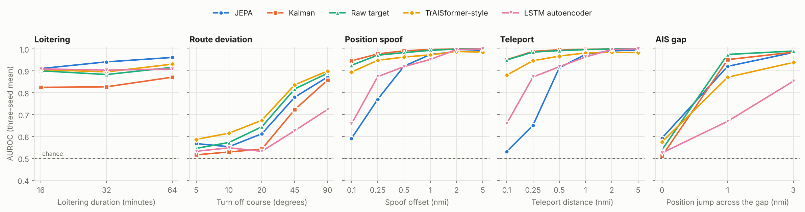
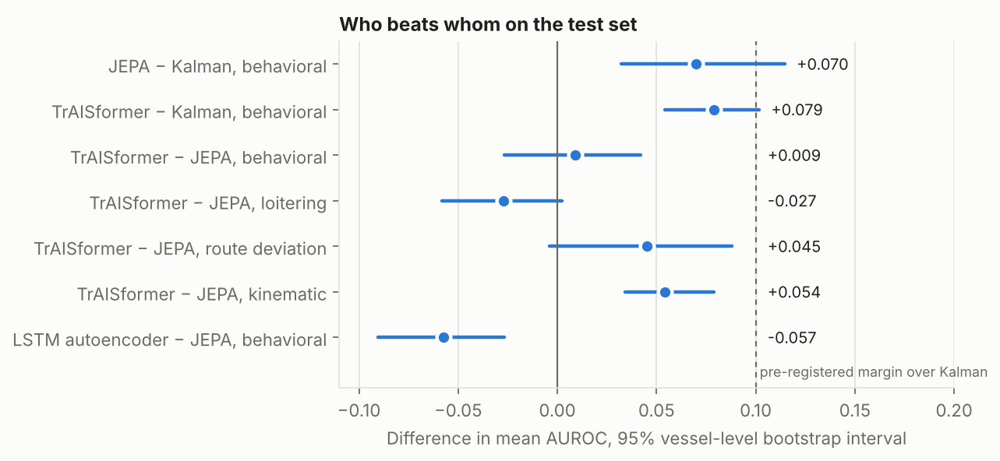
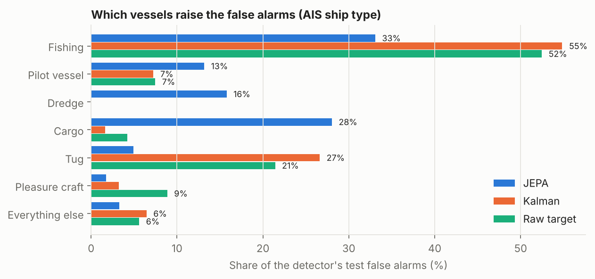
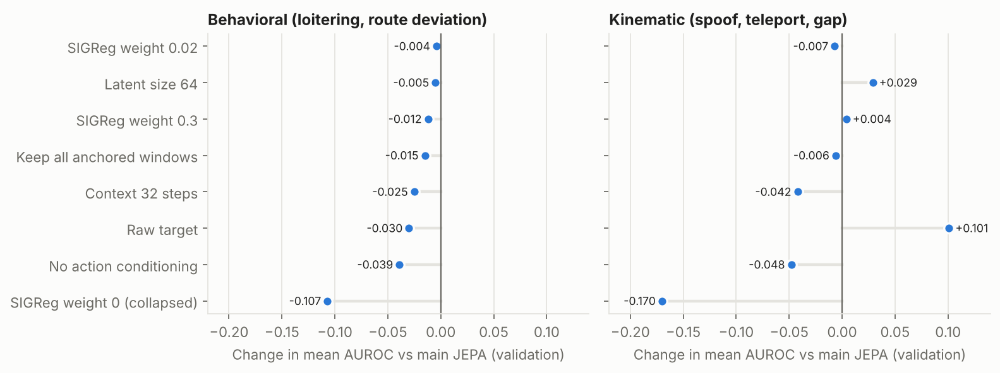

# Latent Wake: does a world model find odd ship tracks better than a Kalman filter?

*Chris Schmidt, November 2026. Code, data pipeline, and every number below:
this repository. Pre-registered criteria: [`DATA_CONTRACT.md`](../DATA_CONTRACT.md).
Full results: [`EVAL_RESULTS.md`](../EVAL_RESULTS.md).*

## Summary

I trained a joint-embedding predictive architecture (JEPA) in the style of
LeWorldModel on three months of AIS vessel tracks from Chesapeake Bay and
Hampton Roads. It predicts each vessel's next 16 minutes in a learned latent
space, given what the ship reports about its own speed and course, and flags
windows it cannot predict. Before scoring the frozen test set, I committed to
three claims with numeric margins. The main one was that the JEPA beats a
Kalman filter on behavioral anomalies (loitering and leaving a route) by at
least 0.10 AUROC.

It does not, at that margin. On 180 held-out vessels:

- **Self-supervised next-step predictors beat Kalman on behavioral anomalies
  by about 0.07 to 0.08 AUROC**, with vessel-level intervals that exclude
  zero. The JEPA's gain is +0.070 (95% interval 0.032 to 0.115). A simpler
  TrAISformer-style forecaster, added later as a baseline, gains +0.079.
- **Predicting in latent space neither helped nor hurt on behavioral
  anomalies overall.** The JEPA and the forecaster are statistically tied
  there (difference +0.009, interval −0.027 to +0.042). The JEPA ranks
  loitering best (0.938 AUROC); the forecaster is better on route deviation,
  spoofing, and teleports, and holds a false-alarm budget better.
- **Fusing the JEPA with Kalman did not pay**, and **no detector held a 1%
  false-alarm budget set on validation vessels** once it met new vessels.
  Most of the JEPA's false alarms come from four vessels: a moored cargo
  ship, a fishing boat, a pilot boat, and a dredge.

The pre-registered verdict was 3 of 8 criteria met. The rest of this write-up
is how I got there, what changed along the way and why, and what I would do
next.

## Why this problem

AIS is the radio beacon commercial ships broadcast every few seconds: identity,
position, speed, course, heading. Analysts use it to spot spoofed positions,
dark periods, and unusual behavior. Most detectors are either rules or
physics (does the position agree with the reported speed?) or models trained
on labeled incidents, which are scarce.

A world model offers a third route: learn what normal traffic looks like from
unlabeled tracks, and flag what it cannot predict. JEPAs are a recent,
cheap way to train one. LeWorldModel showed that a JEPA can be trained end to
end with a single regularizer (SIGReg), without the usual
collapse-prevention tricks such as an EMA target network. My question was whether the same recipe, applied
to vessel tracks on a laptop GPU, finds anomalies a strong classical baseline
misses.

## What I built

**Data.** NOAA MarineCadastre AIS for April to June 2025, cropped to the bay
and Hampton Roads: 43.9 million reports. The main study keeps Class A
transceivers only, the commercial traffic the claim is about (21.9 million
reports, about 2,400 vessels). Tracks are cleaned, cut at gaps over 30
minutes, and resampled to a 2-minute grid. Each step carries relative motion
only: east and north displacement, reported speed, sine and cosine of
reported course, heading change, and whether heading is valid. A window is 64
steps (about two hours). Data are split by time *and* vessel: training uses
the first two months from 70% of vessels; validation and test use June from
two disjoint sets of the remaining vessels.

**Model.** Each 8-step chunk of a window is encoded to a 192-dimensional
latent by a small transformer. A causal predictor, conditioned through
AdaLN-zero on the *next* chunk's reported speed, course, and heading change,
predicts the next latent. Displacement is deliberately left out of that
conditioning: the model has to infer where the ship goes from what it says it
is doing, so a position that disagrees with the reports should surprise it.
The loss is prediction error plus 0.09 × SIGReg, with no EMA target or
stop-gradient. 10.1 million parameters, about 40 minutes per seed on an RTX
A4500.

**Anomalies.** There is no labeled ground truth at this scale, so anomalies
are injected into real held-out tracks with seeded generators at graded
severities. Three kinematic kinds (position spoof, teleport, AIS gap with a
position jump) go into every vessel. Two behavioral kinds (loitering and
route deviation) go only into moving cargo, tanker, and passenger ships, the
vessels for which that behavior would be unusual, and are scored only
against normal windows from the same population.

**Baselines.** A physics consistency check, a Kalman filter that observes
both position and reported velocity, the same predictor trained on raw
features instead of latents (the key JEPA ablation), and, after the main
scoring, an Isolation Forest, an LSTM autoencoder, and a TrAISformer-style
forecaster. The forecaster bins each step's motion, speed, and course,
predicts the next step's bins with a causal transformer, and scores a window
by its least likely step. Unlike TrAISformer it uses relative motion rather
than absolute positions, to match everything else here.

**Scoring.** Every detector's window score is calibrated against validation
windows of the same vessel class and motion state (under way or stopped),
as a tail probability. Thresholds come from a 1% false-alarm budget on
validation.

## Pre-registration, and what changed before the test set was scored

I used my own harness, Meridian, to run the project as a sequence of gates.
The first gate, `data_contract`, required written success criteria with
numeric margins before any real data was trained on. The test set was frozen
with a checksum before any model trained, and the code refuses to score it
twice with different inputs.

Two rounds of validation results changed the contract before the test set
was scored. Each change is in the amendment log with its reason.

1. **Version 2 (population and matching).** Half of all reports came from
   Class B transceivers, mostly pleasure craft. Loitering had been injected
   into tugs and fishing boats, for which it is ordinary work. The fix was a
   Class A population, behavioral anomalies only in transit vessels, and
   calibration by vessel class × under way. The first test set was retired
   unscored.
2. **Version 2.1 (calibration).** A diagnostic I added showed the fused
   detector was sending 99% of its alerts to stopped ships. Strata whose
   normal scores barely varied had near-zero spread, so their z-scores blew
   up. Worse, the JEPA was calibrated per stratum and the Kalman baseline
   was not. Switching every detector to the same tail-probability
   calibration fixed both. It also cost the JEPA its validation pass on two
   criteria, because Kalman gained more from fair calibration. I kept the
   margins rather than lowering them.

I also decided, before scoring, what the evaluation gate means: the test set
was scored once by the pre-registered rules, and the outcome is reported
pass or fail. Validation had already predicted a narrow miss.

## Results

| AUROC, three-seed mean | JEPA | Kalman | Raw target | Fused | TrAISformer-style | LSTM-AE |
|---|--:|--:|--:|--:|--:|--:|
| Loitering | **0.938** | 0.841 | 0.900 | 0.904 | 0.910 | 0.907 |
| Route deviation | 0.677 | 0.634 | 0.694 | 0.664 | **0.722** | 0.592 |
| Position spoof | 0.872 | **0.985** | 0.979 | 0.976 | 0.958 | 0.900 |
| Teleport | 0.843 | **0.989** | 0.987 | 0.981 | 0.957 | 0.901 |
| AIS gap | 0.832 | 0.815 | **0.835** | **0.835** | 0.794 | 0.682 |
| False alarms on test normals (1% budget) | 5.0% | 2.1% | 2.5% | 4.1% | **1.6%** | 1.8% |

The fused detector is the larger of the JEPA's and Kalman's calibrated
scores. The last two columns were scored later in a separately recorded
benchmark, with settings chosen on validation by a rule fixed in advance.

*Detection against severity, in the injected units. The JEPA ranks loitering
best at every duration. On the smallest spoofs and teleports (0.1 to 0.25
nautical miles) it is near chance while Kalman is above 0.94. A gap with no
position jump is nearly invisible to every detector.*

The pre-registered verdict was 3 of 8 criteria met:

| Criterion | Result | Margin | Met |
|---|---|---|---|
| JEPA over Kalman, behavioral AUROC | +0.070 | 0.10 | no |
| JEPA over Kalman, behavioral AUPRC | +0.039 | 0.05 | no |
| Fused over Kalman, AUROC | +0.019 | 0.03 | no |
| Fused over Kalman, AUPRC | −0.061 | ≥ 0 | no |
| Fused over JEPA, AUROC | +0.040 | 0.03 | yes |
| Fused over JEPA, AUPRC | +0.117 | 0.03 | yes |
| Fused false alarms at the 1% budget | 4.1% | ≤ 2% | no |
| Fused detection at budget vs Kalman | 0.501 vs 0.483 | ≥ 0 | yes |

Windows from one vessel are correlated, so the effective sample size is
closer to 172 vessels than to 11,600 windows. A bootstrap that resamples
vessels gives intervals for the differences that matter:

*Both forecasters clearly beat Kalman on behavioral anomalies, and neither
clears the 0.10 margin with any confidence. Between the JEPA and the
TrAISformer-style forecaster, only the kinematic difference is clear.*

## Where the false alarms come from

Validation thresholds for a 1% budget gave 2% to 5% false alarms on test
vessels. Breaking them down by vessel and by AIS ship type shows the misses
are concentrated, not diffuse:

- **Four vessels raise 85% of the JEPA's false alarms.** They are a cargo
  ship moored at the Norfolk terminals (76 of its 136 normal windows), a
  fishing vessel in the mid-bay near Reedville (75 of 124), a pilot boat in
  Baltimore Harbor, and a dredge in Hampton Roads.
- **The fishing vessel trips every detector**, including the physics check.
  Its position and pattern are consistent with purse-seine sets by the
  Reedville menhaden fleet, which the data cannot confirm.
- **Pilot boats and dredges are 24% to 32% of the JEPA's false alarms.** The
  dredge alarms are the JEPA's alone. That fits how the bay works:
  pilot launches run out to ships and match their speed alongside, and
  Army Corps dredges creep back and forth in the channels. Neither moves like
  anything in the training data, and the JEPA has no notion of where the
  channels are. The pilot boat working the Cape Henry boarding area, by
  contrast, raises only a handful.
- **Without the one fishing vessel, Kalman and the raw-target predictor stay
  within the budget** (1.0% and about 1.2%). The JEPA does not (3.5% to
  4.2%).

Vessels are anonymized here and in the repository's reports. A flag means a
track was unusual to a model, not that anyone did anything wrong.

## What the ablations say

Every ablation was run on the validation anomaly set only, with three seeds
wherever a result landed within 0.02 of the main model.

- **SIGReg is what prevents collapse.** Without it, latent effective rank
  fell to 2.6 of 192 and the model became worse than Kalman. Across weights
  from 0.02 to 0.3 the results barely moved.
- **Action conditioning carries the prediction.** Without the reported
  speed and course, prediction loss rose about 30×.
- **Latent prediction trades kinematic sensitivity for loitering.** The
  raw-target predictor is 0.07 worse on loitering and 0.10 better on
  kinematic anomalies. Pooling 8 steps into one latent most likely dilutes
  single-step jumps.
- **A 64-dimensional latent was as good on behavioral anomalies and better on
  kinematic ones.** I found this after the test scoring, so it was not swapped
  into the reported model. It is the configuration to carry forward.
- **No setting improved the behavioral mean.** The missed margin is not an
  untuned knob among those tested.

## What did not work, and what I would try next

- **A learned location embedding** (a vector per 5 km grid cell) lifted
  route deviation by 0.10 on validation but generalized poorly to new
  vessels, and location dropout did not fix it. Route deviation is about
  channels, so the next attempt should be a fixed lane prior (traffic
  density from the training split, or charted channels) rather than a
  learned per-cell vector.
- **Max-fusion with Kalman** added Kalman's false alarms to the JEPA's and
  hid the JEPA's loitering detections at the budget. A fusion that weights
  each detector by anomaly kind, or a learned combiner chosen on validation,
  is the obvious next step, and would need a new pre-registration.
- **Thresholds that transfer between fleets** need either more vessels in
  validation or per-vessel normalization. A detector that alarms on a
  moored ship for a whole day is reacting to that ship, not to an event.
- **Masking known context.** Pilot stations, anchorages, terminals, and
  dredging operations are places where unusual motion is routine. An analyst
  display should show alerts against them.

## Limitations

The anomalies are synthetic, injected into real tracks. Real spoofing,
loitering, and dark activity may not look like the injectors. The data
cover one region, one season, and Class A vessels. Test-set AUROCs are
higher than validation for every method on behavioral kinds (Kalman
loitering 0.84 vs 0.66), because the anomalies were injected into different
windows. The criteria compare methods on the same set, so this does not
favor any method, but absolute numbers should not be read as transferable.
The learned baselines and all pairwise intervals were added after the
pre-registered scoring and are reported as exploratory.

## Reproduce

Every step is a command in [`docs/REPRODUCE.md`](REPRODUCE.md), from download
to the demo panel. The panel is live at
[pcschmidt.github.io/darkwater/latent-wake.html](https://pcschmidt.github.io/darkwater/latent-wake.html). Decisions and their reasons are in
[`DECISIONS.md`](../DECISIONS.md); ablations in
[`ABLATION_RESULTS.md`](../ABLATION_RESULTS.md); the model card in
[`MODEL_CARD.md`](../MODEL_CARD.md). The figures are drawn from committed
results by `python scripts/make_writeup_figures.py`.
